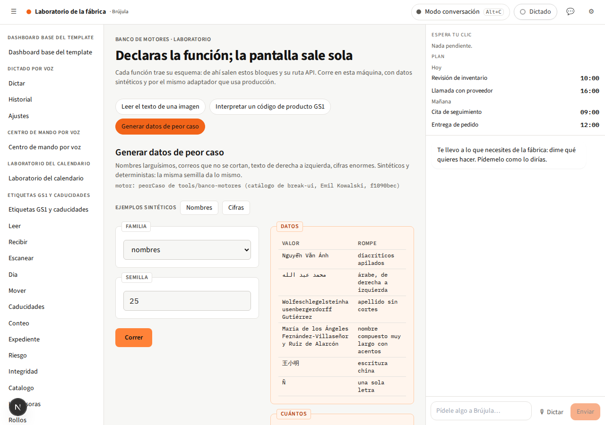
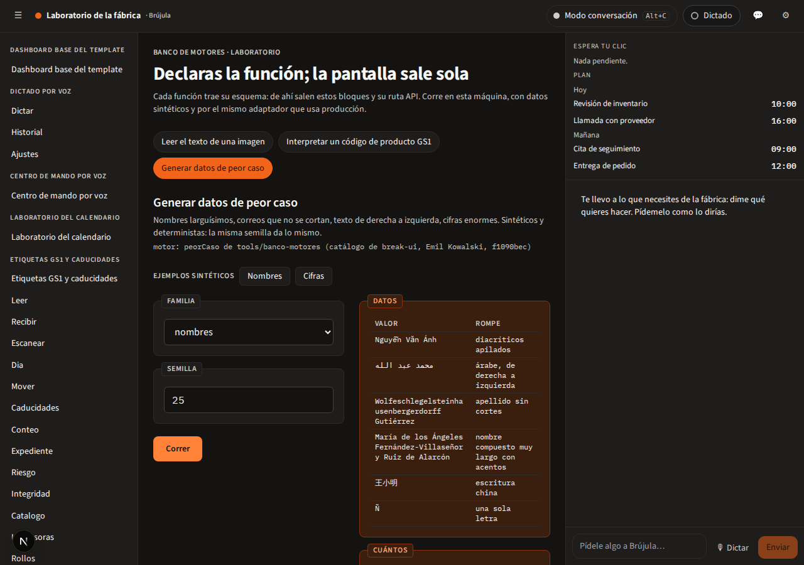
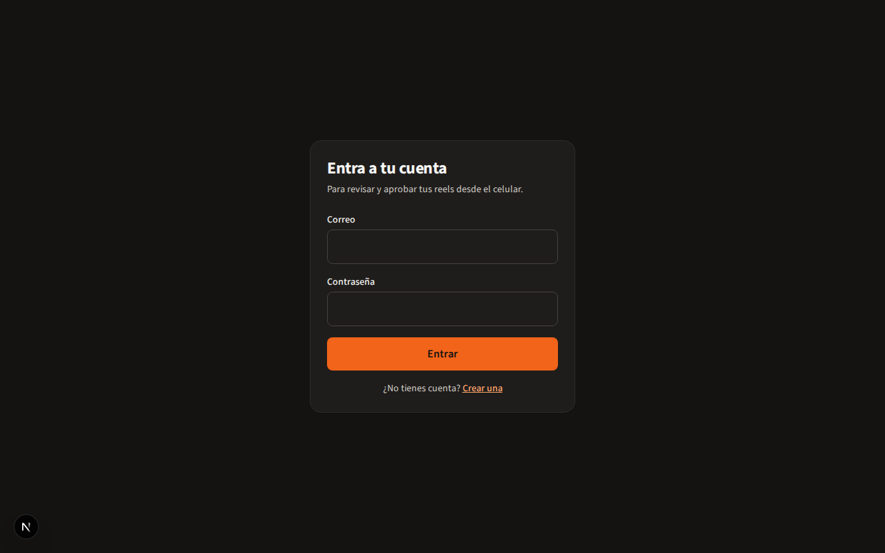

# Turno 25 · Sistema de diseño

> *Procesos que trabajan solos.* Turno 25 transforma y optimiza los procesos de pymes e industria
> pequeña y mediana. Este sistema define cómo se ve, cómo suena y con qué piezas se construye. Es la
> marca de la casa de este repositorio.

Fuente: guía de marca v1.0 (artifact del 26/10/2026, copia en `docs/goals/gradio-marca-turno25-fuente/`).
La «v2» compartida por otra persona no se usa.

## Referencia visual





## Esencia

| Valor | Qué significa en una pantalla |
|---|---|
| **Medible** | Todo empieza y termina en una cifra: horas, errores, retorno. Si no se mide, no se promete. |
| **Práctico** | Se configura en la operación real del cliente. Nada de demos eternas. |
| **Técnico y claro** | Precisión de ingeniería contada en palabras de negocio: entrada, salida, resultado. |

## Una sola fuente

Los tokens viven en `tokens.json` (este directorio) y de ahí se **generan** las salidas de cada runtime:

| Salida | Para qué |
|---|---|
| `src/app/marca.generada.css` | Variables de shadcn (HSL sin función) y de la marca, en claro (`:root`) y oscuro (`.dark`) |
| `src/shared/marca/tokens.generado.ts` | Familias, curvas, duraciones, radios y paleta para `tailwind.config.ts` y el código TS |

```bash
npm run marca:genera      # regenera las dos salidas
npm run marca:comprueba   # exit 1 si alguien editó a mano una salida (lo corre verifica:generados)
npm run marca:contraste   # tabla WCAG de los pares texto/fondo, claro y oscuro
npm run marca:capturas -- --base http://localhost:3000 --rutas /a,/b --salida <dir>
```

Cambiar la marca es editar `tokens.json` y regenerar. Lo generado lleva el banner `ALTO` y no se toca.

## Color

| Rol | Token | Valor |
|---|---|---|
| Naranja Turno: acción, resultado, estado activo | `naranja.500` → `primary`, `marca` | `#F26419` |
| Tinta: texto | `gris.950` → `foreground` | `#141312` |
| Papel: fondo de página | `gris.50` → `background` | `#F7F7F5` |
| Superficie: tarjetas | `gris.0` → `card` | `#FFFFFF` |
| Resultado suave | `naranja.50` / `naranja.700` → `marca-suave` / `marca-suave-fg` | `#FFF5ED` / `#B33D0B` |

Reglas de la guía, ya medidas:

1. **El naranja ocupa menos del 10 % de una pantalla.** `scripts/marca/capturas.mjs` lo mide píxel a píxel
   sobre cada captura (tono 10-40°, saturación ≥ 0,45). Medido el 2026-11-02 en las superficies migradas:
   entre 0,79 % y 1,73 % (claro y oscuro).
2. **Texto sobre naranja, siempre en tinta.** Tinta sobre `#F26419` da 5,84:1 y pasa AA; blanco da 3,18:1
   y falla. El botón primario usa `text-primary-foreground`, que es tinta.
3. **Neutros cálidos.** Nada de grises azulados: la escala `gris` es la única.

Contraste medido (`npm run marca:contraste`): pasan AA todos los pares que emiten los tokens, en claro y
en oscuro, salvo dos. El blanco sobre naranja es justo el que la guía prohíbe. El otro es `fg-3` sobre papel
en claro (4,04:1), un hallazgo de la guía misma: `sutil` se usa solo en texto grande de WCAG (24 px, o
19 px en negrita), donde basta 3:1. El revisor de interfaz lo hace cumplir: `text-sutil` sin `text-2xl` o
mayor es un hallazgo (`sutil-chico`). Subir el valor es decisión del laboratorio para la v1.1.

Los estados (`exito`, `aviso`, `peligro`, `info`) traen `DEFAULT`, `suave` y `texto`. La guía solo define
su versión clara; la oscura se **deriva** en `tokens.json` con `mezcla(a, b, t)` y queda marcada como
propuesta para la v1.1.

## Tipografía

| Familia | Uso | Detalle |
|---|---|---|
| **Source Sans 3** | Interfaz y textos | Variable 400-800, autoalojada en `src/app/fuentes/` (licencia OFL al lado) |
| **IBM Plex Mono** | Cifras, IDs, tiempos y código | 400, 500 y 600. Siempre tabular: la cifra es el héroe |

Títulos en Bold con `tracking-tight`; cuerpo Regular 16/1.5; etiquetas Semibold 12 en mayúsculas con
`tracking-etiqueta`. El nombre se escribe «Turno 25», con espacio, en Source Sans 3 Bold. Todavía no hay
logo: hay tres direcciones en estudio y ninguna elegida.

Ninguna fuente se pide a Google, ni al construir ni al servir.

## El bloque etiquetado

El motivo de la marca: un panel con una etiqueta en la esquina que muestra entrada → salida o
antes → después. Nació del bloque con etiqueta de Gradio; la guía de logotipo lo dice así: *«La referencia
de Gradio orienta el tono, no la forma»*.

```tsx
import { BloqueEtiquetado, Cifra } from '@/shared/components/bloque-etiquetado'

<BloqueEtiquetado etiqueta="Antes">Captura manual de 140 facturas al mes · <Cifra valor={38} unidad="h/mes" /></BloqueEtiquetado>
<BloqueEtiquetado etiqueta="Después" variante="resultado">Extractor documental · <Cifra valor={2} unidad="h/mes" /></BloqueEtiquetado>
```

La variante `resultado` (naranja suave) es **solo** para el resultado. La etiqueta se corta con elipsis y el
contenido parte palabras largas: probado con los datos de peor caso (nombres de 50 letras, árabe, cifras de
13 dígitos).

## Movimiento

| Token | Valor | Clase de Tailwind |
|---|---|---|
| `curvas.salida` | `cubic-bezier(.2,.8,.2,1)` | `ease-out` (y la curva por defecto) |
| `curvas.entrada-salida` | `cubic-bezier(.65,0,.35,1)` | `ease-in-out` |
| `duraciones` | 120, 200 y 320 ms | `duration-rapida`, `duration-base`, `duration-lenta` |

Emil Kowalski decide **cuándo y qué** se anima (y qué se quita); los **valores** salen de aquí. Sus curvas son
más fuertes (`cubic-bezier(0.23, 1, 0.32, 1)` para salir): si se ven mejor, van como propuesta de marca v1.1
con una captura comparativa. Nunca `ease-in` en la interfaz, nunca `transition-all`, nunca desde `scale(0)`.

Quien pide movimiento reducido (`prefers-reduced-motion`) no ve desplazamientos: `globals.css` reduce toda
transición a 1 ms. La guía v1.0 no lo traía; entra aquí como regla de accesibilidad.

## Voz

Cercana, concreta, de tú. Español por defecto, inglés como traducción completa. Sin emoji.

| Sí | No |
|---|---|
| Recuperas 36 horas al mes en facturación. | `Soluciones disruptivas de clase mundial.` |
| Agenda un diagnóstico | `¡¡Contáctanos YA!! (con un cohete)` |
| Necesitamos acceso de solo lectura al banco para continuar. | `Error 403: permisos insuficientes en el conector.` |
| You get 36 hours back every month. | `Unlock synergies with AI-powered 360° solutions.` |

Esta tabla es la **muestra de voz** que se le pasa al skill `humanizer`: su regla dice que la muestra
manda sobre sus patrones. El texto del humanizer queda como vino del upstream; la marca entra por aquí.

## Alineación con shadcn

| Marca | shadcn |
|---|---|
| `accent` (naranja 500) | `primary` |
| `accent-fg` (tinta) | `primary-foreground` |
| `bg-page` (papel) | `background` |
| `bg-surface` | `card`, `popover` |
| `fg-1` / `fg-2` | `foreground` / `muted-foreground` |
| `bg-subtle` | `muted`, `secondary` y el `accent` de shadcn |
| `border-default` / `border-strong` | `border` / `input` |
| `focus-ring` | `ring` |
| `error.600` | `destructive` |
| `radius-md` (8 px) | `--radius: 0.5rem` |

**Trampa de nombres**: el `accent` de la marca es el naranja; el `--accent` de shadcn es el fondo suave del
hover. Si los cruzas por nombre, todos los hovers se vuelven naranjas y la regla del 10 % se rompe.

## Alineación con Gradio

Gradio no es una dependencia del repo: se estudió su arquitectura y se tomó su idea en el **banco de
motores** (`tools/banco-motores` + `/laboratorio-banco`).

| Gradio | En el banco |
|---|---|
| `Interface(fn, inputs, outputs)` | Una función con su esquema Zod de entrada y salida: la pantalla sale sola |
| Componentes con `preprocess` / `postprocess` | Un bloque etiquetado por tipo de esquema, de entrada y de salida |
| `api_name` y «Use via API» | `POST /api/banco/<id>` con el **mismo** esquema, y su JSON Schema en pantalla |
| `examples` | Ejemplos sintéticos (y la tarjeta de caso compartida por los laboratorios) |
| Cola y progreso | Progreso con cronómetro y cancelación |

Lo que no se tomó: `share` (enlaces públicos), Spaces y Hub, analítica, modo MCP y la auth propia.

## Marca blanca

Turno 25 es el default de la casa. Conservan su acento propio, por decisión de producto:

| Producto | Acento | Por qué |
|---|---|---|
| Ágora | `#2a5db0` | Producto con identidad propia |
| Soporte SAP | `#0284c7` | Desplegado (vitrina y mesa); migrarlo exige redesplegar |
| Recepción | `#b45309` | Producto con identidad propia |
| Portal de clínicas | por clínica | Cada clínica es un inquilino con su marca |

La capa del laboratorio sí habla Turno 25 (`src/shared/capa/marca-laboratorio.css`, acotada a
`data-capa-ventana="laboratorio"`).

## Revisores (gates de `validate`)

| Revisor | Qué caza | Regla de origen |
|---|---|---|
| `npm run revisa:interfaz` | Movimiento (`transition-all`, `ease-in`, `scale-0`, curvas y duraciones fuera de tokens, animar el layout), móvil (`100vh`, inputs de menos de 16 px, hover sin puntero, destello al tocar, `viewport-fit`) y color literal | Skills de Emil Kowalski (`f1090bec`) y esta guía |
| `npm run revisa:voz` | `no es X, es Y`, palabras de catálogo, restos de chat, emoji, `usted`, exclamación doble, errores crudos y guiones en cadena | Humanizer (`225a6f39`) y la voz de esta guía |

Lo que ya existía y no cumple está en `inventario-interfaz.json` con su motivo por módulo: es la agenda. El
gate falla si algo sube o si un archivo nuevo trae color literal. Cada revisor tiene `--prueba`, con una
siembra por familia que tiene que caer.

## Skills

| Dónde | Skills | Cuándo |
|---|---|---|
| `.claude/skills/` (se cargan) | `humanizer`, `emil-design-eng` | Siempre a mano: reescribir en la voz y el criterio de oficio |
| `.claude/estante/emil-kowalski/` (se leen por ruta) | `review-animations`, `animation-performance`, `mobile-native`, `break-ui`, `remove-animations`, `animate`, `find-animation-opportunities`, `improve-animations`, `prototype`, `animation-vocabulary` | Al animar algo (`animate`), al revisar movimiento (`review-animations`), al tocar la PWA (`mobile-native`), al probar con datos extremos (`break-ui`) |

El estante no cuesta contexto por sesión. Pasar un skill del estante a `.claude/skills/` es un CDC y tiene
que caber en el presupuesto de 12 000 tokens (hoy van 11 477).

## Decisiones abiertas del laboratorio

- Subir `fg-3` para que pase AA en texto normal (hoy 4,04:1).
- Adoptar como v1.1 los estados oscuros derivados y, si convencen, las curvas de Emil.
- Elegir logo entre las tres direcciones.
- Migrar Ágora, Soporte SAP, Recepción o el portal de clínicas a Turno 25, producto por producto.
