# Soporte SAP × la web: SAP BASIS vigente y citado, como candidatos de la mesa

**Borrador para firma del laboratorio** · 2026-10-23 · rama `soporte/basis-web` (apilada sobre `soporte/sapstack-cita`,
`9dbf4c7`). Fuentes fijadas en `src/features/soporte-sap/mesa/fuentes/web/pin.json`: CVE List `8a8e45d`, KEV `fd12990`
(catalogVersion 2026.10.21), SAP-docs `beb6ec7` (Cloud ALM), `de187b5` (Connectivity) y `a4677a4` (ABAP Trial),
capturadas el 2026-10-23. La evidencia se reproduce con
`node docs/goals/soporte-sap-basis-web-evidencia/mide.mjs <captura>` (solo lectura; dos corridas dan lo mismo) y su
salida completa está en el anexo (`soporte-sap-basis-web-propuesta-anexos.md`).

## Índice

1. En una página
2. Lo que se investigó: la web de hoy y tres bases curadas con procedencia
3. El catálogo de fuentes
4. La matriz de cobertura y sus huecos
5. Cómo se fija una fuente web
6. Los candidatos nuevos en la mesa
7. El cruce con sapstack
8. El grafo, corrido
9. «Vigente» que se sostiene solo
10. La vista
11. Derechos y términos: lo que se copia y lo que no
12. Controles: las filas nuevas de la matriz
13. Decisiones del laboratorio
14. Lo que podría estar mal
15. Referencias

## 1. En una página

**Qué cambia para una consultora N2.** El experto ya no valida solo hipótesis de sapstack. Ahora valida también 213
candidatos de BASIS tomados de fuentes públicas fijadas: **105 notas de seguridad** (22 Hot News, 6 explotadas según
CISA), **104 SAP Notes** que la documentación de SAP cita en sus guías y **4 transacciones** que sapstack no traía. Cada
candidato lleva su cita y la fecha de su captura. A cada uno de los 73 candidatos de BASIS/BC de sapstack la mesa le
enseña si una fuente citable lo **corrobora** (14), lo **contradice** (0) o **no lo encuentra** (59). Una corroboración
es lo que D-SS-2 pedía para que un candidato de sapstack pueda llegar a regla: el experto sigue decidiendo.

**El hallazgo que cambió el diseño.** help.sap.com y support.sap.com dicen en su robots.txt `User-agent: *` /
`Disallow: /`: solo dejan entrar a los buscadores que nombran. Los términos de los sitios de SAP prohíben además la
extracción automatizada, también la que se hace para minar texto y datos. Por eso **nada de este goal baja una página de
SAP con una herramienta**. Lo de SAP entra por los dos canales en que SAP lo publica para que otros lo reusen:

- sus **registros como CNA en el CVE List**, que se pueden reproducir según los términos del CVE;
- su **documentación en SAP-docs**, en GitHub y con CC BY 4.0.

SAP Help, el Patch Day de support.sap.com y la estrategia de mantenimiento quedan a **lectura humana**, y sus huecos
quedan declarados (sección 4).

**Por qué no da un veredicto inventado.** Ningún candidato da veredicto: en el motor, los 5 escenarios de BASIS van «al
experto» (sección 8). Validar es una propuesta. Una regla se firma en `tools/conocimiento` con su cita, y la política de
cita la rechaza mientras no esté anotada y firmada en CAMBIOS.md: los 262 candidatos del paquete de prueba la rechazan
por eso, y los 44 de sapstack sin corroborar, además, por citar a sapstack.

**Qué pide al laboratorio.** Firmar la revisión 13 de la AISIA (firmada el 2026-10-24:
`.claude/gobernanza/AISIA-soporte-sap.md`), decidir D-BW-1 a D-BW-8 (aceptadas el 2026-10-24, sección 13) y desplegar con
`despliega.sh`. El ciclo mensual (descubrir, capturar, extraer y revisar) lo corre el laboratorio en su máquina.

## 2. Lo que se investigó: la web de hoy y tres bases curadas con procedencia

**La web de hoy (2026-10-23).**

- **Patch Day.** El de octubre fue el 13: según los resultados de búsqueda, SAP publicó 16 notas nuevas y 2
  actualizadas, y los resúmenes de terceros no cuadran entre sí (21 o 22 en total). El de septiembre fue el **8**, el
  segundo martes: 19 notas nuevas y 1 actualizada, según SAP, SecurityBridge y el CCCS canadiense. La más alta fue la
  3747649 (Extended Passport), y el registro de SAP en el CVE List fijado lo confirma: CVSS 10.0, publicada el
  2026-09-08. El próximo es el **10 de noviembre**.
- **El CVE List.** SAP es CNA y publica cada nota con CVE el mismo día del Patch Day, con título, CVSS 3.1, CWE,
  producto y versiones afectadas. Medido: **224 CVE de SAP** del 2025-11-01 al 2026-10-23, y 218 llevan el enlace a su
  nota.
- **KEV.** La versión 2026.10.21 tiene 14 entradas de SAP, la más reciente de mayo de 2025 (Visual Composer).
- **SAP-docs.** De sus 38 repositorios, 3 sirven para BASIS: Cloud ALM, Connectivity y ABAP Trial. Cloud Transport
  Management se evaluó, pero no nombra ningún T-code de AS ABAP.
- **robots.txt y términos.** help.sap.com (2025-10-17), support.sap.com (2025-03-19), www.sap.com, news.sap.com y
  learning.sap.com cierran `*`. SAP Community deja rastrear con espera, pero es un sitio de SAP (mismos términos) y
  politica-cita no la admite. Los términos de SAP Websites solo dejan rastrear a los buscadores autorizados en robots.txt.
- **SAP Learning.** No se confirmó un learning journey gratuito de BASIS (dato del spec, sin cambios).

**Tres referencias de bases curadas con procedencia, y lo que se tomó de cada una.**

| Referencia | Cómo cuida la procedencia | Lo que se tomó |
|---|---|---|
| **KCS v6** (Consortium for Service Innovation) | Un artículo pasa por estados: *Work in Progress*, *Not Validated* y *Validated*. Lo valida quien tiene licencia para hacerlo, y «reuse is review»: se revisa al usarlo | candidato (no validado) → experto (lo valida al usarlo) → laboratorio (publica, firmando). La validación es una propuesta |
| **OSV / GitHub Advisory Database** | Cada registro trae `published`, `modified` y `withdrawn`, y `aliases` que cruza identificadores (CVE ↔ GHSA). Vive en git | el pin por SHA de git; el cruce CVE ↔ SAP Note; la revisión que mira lo nuevo desde la captura |
| **CISA KEV** | El catálogo entero lleva `catalogVersion` y `dateReleased`, y cada entrada su `dateAdded` y su nota con la fuente | fijar por versión además de por SHA, y marcar «explotada desde» con su fecha |

A eso se suma el patrón de las referencias de Wikidata: cada dato lleva su URL de referencia y su fecha de consulta
(«retrieved»). Aquí, cada candidato lleva su cita, la fecha de su captura y la huella de lo leído.

## 3. El catálogo de fuentes

16 fuentes, en `fuentes/web/catalogo.json` (lo escribe una persona; la captura obedece su campo «captura»). La tabla
completa, con términos y releases, está en el anexo (sección 1). En resumen:

| Fuente | Tipo | Acceso | Captura | ¿Cita admitida? |
|---|---|---|---|---|
| CVE List: registros de SAP como CNA | primaria (SAP autora) | pública | **automática**, por SHA | sí: la SAP Note de cada registro |
| NVD (NIST) | secundaria | pública | automática (solo descubre) | no da citas |
| CISA KEV (cisagov/kev-data) | secundaria | pública | **automática**, por SHA y versión | no da citas |
| SAP-docs: Cloud ALM | primaria | pública, CC BY 4.0 | **automática**, por SHA | sí: su página de SAP Help |
| SAP-docs: Connectivity (Cloud Connector) | primaria | pública, CC BY 4.0 | **automática**, por SHA | sí: su página de SAP Help |
| SAP-docs: ABAP Platform Trial | primaria | pública, CC BY 4.0 | automática, por SHA | **no**: no vive en help.sap.com |
| SAP-docs: Cloud Transport Management | primaria | pública, CC BY 4.0 | no (0 T-codes de AS ABAP) | — |
| sapstack | secundaria | pública, MIT | ya fijada (revisión 12) | no (D-SS-2) |
| SAP Help Portal | primaria | pública | **lectura humana** (robots + términos) | sí |
| SAP Security Patch Day (support.sap.com) | primaria | pública | **lectura humana** | no |
| Estrategia de mantenimiento (support.sap.com) | primaria | pública | **lectura humana** | no |
| PAM | primaria | **S-user** | no | — |
| SAP Notes (me.sap.com) | primaria | **S-user** | no: solo número, título y enlace | sí (el enlace) |
| SAP Learning | primaria | registro | no | — |
| SAP Community | secundaria | pública | no (términos; no admitida) | no |
| Resúmenes de terceros del Patch Day | secundaria | pública | no (repiten el CVE List) | no |

## 4. La matriz de cobertura y sus huecos

Contada por `mide.mjs` sobre lo fijado. Para cada área se cuenta:

- **sapstack**: sus candidatos de BASIS/BC del área;
- **CVE List**: las notas de seguridad cuyo producto la nombra;
- **SAP-docs**: los candidatos que salen de una página que nombra el área o una transacción suya;
- **corroborados**: los T-codes de sapstack del área que SAP Help nombra.

| Área de BASIS | sapstack | CVE List (+KEV) | SAP-docs | sapstack corroborado | Estado |
|---|---|---|---|---|---|
| Copia de sistemas e instalación | 2 | 0 | 0 | 0 | **hueco** |
| Kernel, SPAM/SAINT y SUM | 4 | 0 (19 notas traen versiones de kernel) | 0 | 1: SM51 | mínima |
| Transportes (STMS/CTS, tp, R3trans) | 4 | 1 | 1 | 1: STMS | mínima |
| Usuarios y roles | 7 | 22 (1 explotada) | 4 | 2: PFCG, SU01 | en parte |
| Seguridad (Patch Day, SNC, STRUST, gateway, SM59, UCON) | 3 | 73 (5 explotadas) | 22 | 2: SM59, STRUST | en parte |
| Jobs | 2 | 0 | 1 | 1: SM37 | mínima |
| Monitoreo y diagnóstico | 13 | 5 (1 explotada) | 1 | 3: SLG1, SM12, SMICM | en parte |
| HANA | 1 | 19 | 9 | 0 | en parte |
| Clientes (SCC4, SCCL) | 6 | 0 | 0 | 1: SCC4 | mínima |
| Impresión (SPAD, SP01) | 0 | 0 | 0 | 0 | **hueco** |
| Licencias | 1 | 0 | 1 | 1: SLICENSE | mínima |
| AS Java (Visual Composer, Portal) | 0 | 22 (4 explotadas) | 0 | 0 | en parte |
| Ciclos de mantenimiento y fin de soporte | 0 | 0 | 0 | 0 | **hueco** |
| RISE y Cloud ALM | 0 | 15 | 77 | 0 | en parte |

**Huecos declarados, no tapados.**

- **Copia e instalación, impresión y ciclos de mantenimiento** no tienen ninguna fuente automática y citable.
- **El procedimiento de cada tarea** (SPAM/SAINT, SUM, SCC4, SPAD, DBACOCKPIT) vive en SAP Help: a lectura humana.
- **Las notas de seguridad sin CVE** (actualizaciones, componentes de terceros) solo están en la página del Patch Day.
- **Las fechas de fin de mantenimiento** están en support.sap.com y en la PAM (S-user).

Lo que la base sí cubre bien es **la seguridad vigente**, con número, CVSS, versiones afectadas y fecha, que es lo que
más cambia mes a mes. Una fila no es un número de páginas leídas: cuenta candidatos y corroboraciones reales.

## 5. Cómo se fija una fuente web

Una página web no tiene SHA, pero todas las fuentes que se capturan viven en git. Por eso cada fuente se fija igual que
sapstack: **por el SHA del commit**, y KEV, además, por su `catalogVersion`. Del CVE List, que cambia cada pocos minutos,
se fija un commit y la **lista exacta de 238 registros**: 224 vienen de NVD y 14 de KEV.

```mermaid
flowchart LR
  NVD["NVD: ¿qué CVE son de SAP?"] -->|"guion: extrae.mjs web descubre"| P["pin-propuesto.json (fuera del repo)"]
  P -->|"humano: el laboratorio mueve el pin"| PIN["web/pin.json · SHA + versión + lista"]
  PIN -->|"guion: extrae.mjs web captura (git, por SHA, fuera del repo)"| C["captura local"]
  C -->|"guion: extrae.mjs web (se niega si no está en su SHA o fue alterada)"| K["candidatos-web.json · huella"]
  K -->|"la mesa lo carga solo si huella y pin cuadran"| M["mesa: candidatos + cruce"]
  M -->|"humano: el experto valida"| PR["propuestas"]
  PR -->|"humano: firma del laboratorio, con su cita"| R["tools/conocimiento"]
  PIN -->|"guion: extrae.mjs revisa (avisa, no mueve)"| RV["pin.json · revision"]
```

- **Captura**: `extrae.mjs web captura <carpeta>` baja cada fuente por su SHA con git, a una carpeta **fuera del repo**
  (se niega dentro). Solo pasa lo que el catálogo marca como público y automatizable: me.sap.com, la PAM, help.sap.com y
  support.sap.com se niegan siempre. Bajarlo todo tardó 15 s.
- **Extracción**: `extrae.mjs web <carpeta>`. Se niega si una copia no está en su SHA o tiene un cambio, y si una
  hipótesis repitiera ocho palabras de la prosa capturada. Medido: dos corridas dan `sha256:688035c4…` y la del repo es la
  misma; con el CVSS de la 3797111 cambiado en una copia, responde «la captura «CVE List» fue alterada (1 archivo(s)
  distinto(s) de su SHA): no se extrae de ella».
- **Formato**: `candidatos-web.json` lleva el banner ALTO, el pin dentro y su huella, como el de sapstack. La mesa lo
  rechaza editado a mano o de otra captura (fila `c3-mesa-web-fijada`).

## 6. Los candidatos nuevos en la mesa

El contrato `Candidato` crece con campos opcionales, así que los de sapstack no cambian:

- `origen: 'web'`;
- `cita`, en la forma que admite politica-cita;
- `captura`, con la fuente, el SHA, la fecha y la huella;
- `seguridad`, con CVE, CVSS, vector, prioridad, fecha, Patch Day, CWE, producto, versiones y «explotada desde»;
- `contexto`;
- `corroboracion`, solo en los de sapstack.

| Clase | Cuántos | De dónde | Cita |
|---|---|---|---|
| Nota de seguridad | 105 (98 BASIS, 5 FI, 2 HCM; 22 Hot News, 17 altas, 55 medias, 10 bajas; 6 explotadas) | el registro de SAP en el CVE List (+KEV) | `me.sap.com/notes/N`, «SAP Note N» |
| SAP Note citada por SAP | 104 (102 en alcance) | las guías de SAP-docs (79 de Cloud ALM, 21 de Connectivity y 4 de ABAP Trial) | `me.sap.com/notes/N` |
| T-code que sapstack no traía | 4: CERTRULE, SAML2, SICF, SNC0 | Connectivity | su página de SAP Help |

Quedan fuera los CVE de productos que Soporte SAP no atiende: 110 notas (Commerce, BusinessObjects, BTP, MII…), además
de 9 registros sin número de nota. Se cuentan en el anexo, pero no entran como candidatos.

## 7. El cruce con sapstack

Lo mide `cruce.mjs`, de solo lectura: dos corridas dan `sha256:e78013c2480c44bc`. Las reglas son estas:

- **corroborado**: una fuente que politica-cita admite nombra el T-code como transacción. Hoy esa fuente es SAP Help,
  vía SAP-docs.
- **contradicho**: una fuente citable lo nombra como otra cosa (reporte, tabla), o da a la nota otro título.
- **no encontrado**: ni lo uno ni lo otro. Una mención en una fuente no admitida, como ABAP Trial, no corrobora.

| | Corroborados | Contradichos | No encontrados |
|---|---|---|---|
| **73 de BASIS/BC** | **14** | **0** | **59** |
| T-codes (58) | 14 | 0 | 44 |
| SAP Notes (15) | 0 | 0 | 15 |
| módulo BASIS (61) | 14 | 0 | 47 |
| módulo ABAP (19, compartidos) | 0 | 0 | 19 |

Los corroborados son PFCG, RZ10, SCC4, SLG1, SLICENSE, SM12, SM30, SM37, SM51, SM59, SMICM, STMS, STRUST y SU01, cada
uno con su página de SAP Help (anexo, sección 4). Fuera de BASIS/BC, SE16 también queda corroborado.

**Lo que dice y lo que no.** Corroborar dice que SAP usa esa transacción en una tarea documentada. No dice que el
nombre o la release que sapstack le pone sean correctos: eso lo decide el experto. **Ninguna de las 15 notas de
BASIS/BC de sapstack aparece en una fuente fijada**: ni en los 238 registros de SAP ni entre las 101 notas que citan las
guías. Cuadra con lo medido en la revisión 12: sapstack no cita nada, y algunos de sus títulos no se pudieron
verificar.

## 8. El grafo, corrido

Los 204 candidatos web de BASIS y los 58 T-codes de BASIS/BC de sapstack se escribieron con el contrato del grafo en un
paquete de prueba `0.0.1-candidato`, que nunca se registró. Todos van con veredicto `escalar_al_experto`, y cada uno
lleva su grado: 14 corroborados, 204 hipótesis citables y 44 hipótesis.

- `validaConocimiento`: **ok**, 262 categorías y 262 reglas, sin problemas.
- `problemasDeCita` (la suite de sap-soporte, sin CAMBIOS.md) da **306 problemas**. Los 262 no están anotados ni
  firmados en CAMBIOS.md; 44 de ellos, además, citan a sapstack. La forma de la cita de los 204 de la web pasa. Así se
  ve que **la mesa no siembra**: un candidato bien citado tampoco entra sin la firma.

| Escenario | Hoy (`categoriza`) | Con candidatos | Grado | Destino y por qué |
|---|---|---|---|---|
| Un job cae con dump TIME_OUT (ST22) | sin módulo | ST22 | hipótesis | **al experto**: ST22 viene solo de sapstack y nada lo corrobora |
| Transporte con RC 8 en STMS | sin módulo | STMS | corroborada | **al experto**: SAP Help (Cloud ALM, TMS) nombra STMS, pero nadie lo validó ni firmó |
| Falta la SAP Note 3797111 (CVSS 9.9) | sin módulo | la nota 3797111 | hipótesis citable | **al experto**: es Hot News y trae cita, pero aplicarla depende del sistema |
| Job cancelado en SM37 | BASIS, SM37 | SM37 | corroborada | **al experto**: corroborada, sin validar |
| Usuario bloqueado (SU01) | BASIS, SU01 | SU01 | corroborada | **al experto**: corroborada, sin validar |

**Lo que enseña.** La web añade el vínculo que faltaba: un ticket que nombra una nota de seguridad ya llega con su CVSS,
sus versiones y su cita. El de TIME_OUT sigue sin regla por síntoma, como los escenarios 04 y 05 de sapstack: un dump
solo lo puede enseñar el experto.

## 9. «Vigente» que se sostiene solo

`extrae.mjs revisa` pregunta a cada fuente y lo apunta en `pin.json` → `revision`. **Avisa y no mueve**: si cambiara
`capturadoEl`, `ventana`, `ultimoPatchDay`, `cvelist`, `kev` o `sapDocs`, se niega. Lo que pregunta:

- el calendario: el segundo martes que sigue al Patch Day fijado;
- NVD: si hay CVE de SAP publicados después de la captura;
- KEV: si su último commit trae entradas de SAP que el pin no tiene;
- SAP-docs: si hay un commit nuevo.

- **Real, hoy**: «✓ la web de BASIS está al día (2026-10-23; el próximo Patch Day es el 2026-11-10)», y el pin no se
  movió.
- **Simulada** (`--hoy 2026-11-11 --sin-red`, sobre una copia): «! hay versión nueva · Patch Day del 2026-11-10: SAP ya
  publicó sus notas de ese mes y el pin sigue en el del 2026-10-13», y lo fijado no cambia.
- El mapa enseña «al día · 2026-10-23» o «hay versión nueva»: mover el pin lo decide el laboratorio (D-BW-2).

## 10. La vista

- **En la mesa** (pestaña de candidatos), un filtro de fuente (todas, sapstack o la web). La tarjeta de un candidato de
  la web enseña su cita, el día de su captura, su fuente con el SHA, la huella, el CVSS con su prioridad y si está
  explotada. La de uno de sapstack enseña su cruce: corroborado (con las páginas de SAP Help), contradicho o no
  encontrado. El experto valida las dos igual.
- **En el mapa del laboratorio**, «La web (BASIS)» es un nodo con sus 213 candidatos, la fecha de captura y su estado.
  Su detalle enseña cada fuente con su SHA, licencia y conteo, el cruce y la revisión. Las propuestas de la web enseñan
  su cita y su captura.
- **Recorrido de Playwright** (`recorrido-mesa.mjs`, pasos 19 a 26): 26/26 en verde, 0 errores de consola, las 7
  negativas en 404. Las capturas están en `docs/goals/soporte-sap-basis-web-capturas/`.

## 11. Derechos y términos: lo que se copia y lo que no

- **Lo que entra**: hechos (número de nota, CVE, CVSS, vector, CWE, producto, versiones, fechas, T-codes), el título de
  una nota o de una página y el enlace, con hipótesis escritas con palabras propias. Del **contenido** de una SAP Note no
  entra nada.
- **Por qué se puede**: lo protegido es la redacción, no los hechos. La LFDA (art. 14, fr. I) excluye «las ideas en sí
  mismas, las fórmulas, soluciones, conceptos, métodos, sistemas, principios, descubrimientos, procesos e invenciones de
  cualquier tipo». El aviso de SAP («no part of this publication may be reproduced…») protege su publicación. Además,
  los dos canales usados licencian la reproducción: los términos del CVE y CC BY 4.0. **No es asesoría legal.**
- **Lo que no se hace**: bajar con una herramienta páginas que el robots.txt o los términos de SAP cierran. Esta regla
  es más estricta que la del derecho de autor: los términos de SAP prohíben la extracción automatizada aunque lo
  extraído sean hechos.
- **Cómo se comprueba**: el generador se niega si una hipótesis repite ocho palabras seguidas de la prosa capturada
  (descripciones de CVE y párrafos de las guías). Una prueba lo verifica con prosa sintética, y su sabotaje lo tumba.
- **Atribución**: cada candidato de SAP-docs enlaza su archivo en el SHA, con su licencia, y el catálogo cita la
  licencia de cada fuente. El aviso de NVD va en el catálogo.

## 12. Controles: las filas nuevas de la matriz

12 filas: 9 probadas (verdes sin sabotaje y rojas con él) y 3 brechas. La matriz entera está en el anexo, sección 8.

| Fila | Afirmación | Sabotaje que la tumba |
|---|---|---|
| `c3-mesa-web-fijada` | solo entran candidatos de capturas fijadas, con su huella | la mesa carga un catálogo editado |
| `c3-mesa-web-sin-salida` | la mesa alojada no sale a la web | la mesa pregunta a NVD al enseñar la fuente |
| `aisia-web-captura-alterada` | la extracción se niega ante una copia alterada o en otro SHA | se extrae de una copia alterada |
| `aisia-web-corrobora-admitida` | corrobora solo una fuente que politica-cita admite | cualquier fuente corrobora |
| `aisia-web-revisa-no-mueve` | la revisión avisa y no mueve el pin | la revisión mueve el último Patch Day |
| `aisia-web-propuesta` | validar un candidato web es una propuesta | toda validación queda firmada |
| `aisia-web-sin-pasajes` | ningún pasaje de una captura aparece en lo extraído | la hipótesis lleva la descripción y la guarda se apaga |
| `aisia-web-nota-solo-numero` | de una SAP Note, solo número, título y enlace | la nota lleva la descripción del registro |
| `aisia-web-sin-s-user` | lo que pide S-user, o lo que el robots.txt o los términos cierran, no se captura | se captura cualquier fuente del catálogo |
| `aisia-web-lectura-humana` · `aisia-web-url-ayuda` · `aisia-web-prioridad-derivada` | brechas declaradas (sección 14) | — |

## 13. Decisiones del laboratorio

**Decididas el 2026-10-24**: el laboratorio aceptó las ocho recomendaciones. D-BW-1, D-BW-5 y D-BW-8 ya son como se
construyó, y D-BW-3 y D-BW-4 dicen que no: politica-cita no cambia, así que no piden CDC. D-BW-2 es el ciclo mensual
de `docs/MESA-DEL-EXPERTO.md`. D-BW-6 se hace en la mesa, con el experto, y la ficha de fin de mantenimiento la
escribe el laboratorio a mano. D-BW-7 es el despliegue, ya con la revisión 13 firmada.

| # | Decisión | Recomendación (aceptada) |
|---|---|---|
| D-BW-1 | ¿Lo de SAP entra solo por los canales que lo permiten (CVE List, SAP-docs), y SAP Help y support.sap.com quedan a lectura humana? | **Sí.** Si un día se quiere cubrir los huecos con SAP Help, se pide permiso por escrito a SAP; no se rodea el robots.txt |
| D-BW-2 | ¿Cada cuánto se mueve el pin? | **Cada mes, a mano, el día después del Patch Day** (miércoles): `descubre` → mirar el diff de `pin-propuesto.json` → mover el pin → `captura` → `web` → revisar el diff de candidatos. Nunca en automático |
| D-BW-3 | ¿Se admite el CVE List (cve.org) como cita en politica-cita? | **No por ahora.** La regla cita la SAP Note (ya admitida); el registro CVE va como evidencia en CAMBIOS.md. Admitirlo es un CDC de la suite |
| D-BW-4 | ¿Se admite github.com/SAP-docs como cita? | **No.** Es la misma documentación que SAP Help, y la cita va a su página de SAP Help, que el experto abre al validar (brecha `aisia-web-url-ayuda`) |
| D-BW-5 | ¿Qué ventana de CVE? | **Desde el 2025-11-01, sin sacar nada**, más todas las de KEV. Recortar lo decide el laboratorio cuando el experto lo pida |
| D-BW-6 | ¿Cómo se tapan los huecos (copia, impresión, ciclos)? | **Con el experto**: casos y enseñanzas en la mesa, como experiencia documentada (admitida). Para fin de mantenimiento, una ficha a mano del laboratorio con su enlace a support.sap.com, leída por una persona |
| D-BW-7 | ¿Se despliega la mesa con la web? | **Sí**, después de firmar la revisión 13, con `despliega.sh` |
| D-BW-8 | ¿La prioridad derivada del CVSS basta? | **Sí, etiquetada** («en la escala de SAP»). Si la del Patch Day difiere, el experto la corrige en la mesa |

**Controles que pide.** AISIA: la revisión 13, firmada el 2026-10-24. C3: dos filas nuevas en «La mesa del experto alojada»,
sin control nuevo. CDC: ninguno (no se toca politica-cita, ni skills, ni gates). Lo serían D-BW-3 y D-BW-4.
**C5**: ninguno, porque los dos daños nuevos son infirmables y se evitan con controles (revisión 13, §5). **Costo**: sin
APIs de pago ni modelo. NVD sin llave (de 2 a 4 peticiones al mes), unos 220 MB de captura en la máquina del
laboratorio, y la mesa gana 437 KB de catálogo.

## 14. Lo que podría estar mal

| Riesgo | Estado |
|---|---|
| Que el robots.txt y los términos de SAP pesen así es una lectura propia, no asesoría legal | **declarado**; D-BW-1 lo deja en manos del laboratorio |
| La URL de SAP Help sale del loio de cada archivo (`<guía>/<loio>.html`, la forma que usa SAP) y nadie la abrió | **brecha** (`aisia-web-url-ayuda`): el experto la abre al validar |
| La prioridad se deriva del CVSS; SAP puede publicar otra | **brecha** (`aisia-web-prioridad-derivada`), etiquetada en pantalla |
| El módulo sale de una regex sobre el producto del registro (98 BASIS, 5 FI, 2 HCM, 110 fuera) | **revisado a mano**: 6 de los 7 de FI y HCM están bien; SAP Financial Consolidation (de EPM) cuenta como FI, y Enterprise Search for ABAP como BASIS. El experto corrige |
| Detectar menciones por contexto («transaction», «in SM37», «(SM12)») pierde algunas («Check ST22» no cuenta) | **declarado**: falla hacia «no encontrado», nunca hacia «corroborado» |
| Corroborar no valida el nombre ni la release que sapstack da | **por diseño**: lo dice la tarjeta y lo decide el experto |
| 0 contradichos: el detector solo ve otro título u otro tipo | **declarado**; probado con datos sintéticos (un reporte tomado por T-code y una nota con otro título) |
| Un registro CVE ya fijado puede actualizarse (cambia su `dateUpdated`) y la revisión no lo ve: solo mira lo nuevo | **abierto**: lo atrapa el `descubre` del mes siguiente, al mover el pin, como diff de candidatos |
| El descubrimiento depende de NVD; un CVE de SAP que NVD no liste no entra | **declarado**: KEV y el calendario lo acotan |
| Tres registros viejos de KEV (2020–2021) no traen título, y uno de SAP trae un carácter mal codificado («Financials � General Ledger») | **declarado**: es así en la fuente; se enseña tal cual |
| El filtro de la mesa toma «Visual Composer» por un nombre de persona y rechaza el comentario | **abierto, a propósito**: es el léxico ya medido en la revisión 12; cambiarlo es AISIA. El recorrido usa otra frase |
| El recorrido depende de que la 3797111 siga en el pin | **declarado**: si sale, el paso 21 se cambia por otra nota de seguridad |
| GitHub y NVD ven la IP de la máquina que captura | **declarado** en la §1 de la revisión 13; no reciben datos |
| La captura vive en la máquina del laboratorio; si se pierde, se vuelve a bajar por SHA | **resuelto**: git baja un commit por su SHA mientras GitHub lo conserve |
| La mesa manda ahora ~506 KB de candidatos por visita (antes, ~230 KB) | **aceptable hoy**; paginar en el servidor si crece |

## 15. Referencias

- robots.txt: https://help.sap.com/robots.txt (2025-10-17), https://support.sap.com/robots.txt (2025-03-19), https://www.sap.com/robots.txt
- SAP, Terms of Use for SAP Websites: https://www.sap.com/about/legal/terms-of-use.html · copyright: https://www.sap.com/about/legal/copyright.html
- SAP Security Patch Day, octubre de 2026: https://support.sap.com/en/my-support/knowledge-base/security-notes-news/october-2026.html (por búsqueda, no capturada)
- CCCS, SAP security advisory (AV26-894), septiembre de 2026: https://cyber.gc.ca/en/alerts-advisories/sap-security-advisory-september-2026-monthly-rollup-av26-894
- CVE Program, Terms of Use: https://www.cve.org/Legal/TermsOfUse · CVE List V5: https://github.com/CVEProject/cvelistV5
- NVD, Terms of Use: https://nvd.nist.gov/developers/terms-of-use («This product uses data from the NVD API but is not endorsed or certified by the NVD.»)
- CISA KEV (CC0): https://github.com/cisagov/kev-data
- SAP-docs (CC BY 4.0): https://github.com/SAP-docs/cloud-alm-setup-admin-guide · https://github.com/SAP-docs/btp-connectivity · https://github.com/SAP-docs/abap-platform-trial-image
- KCS v6 Practices Guide: https://library.serviceinnovation.org/KCS/KCS_v6/KCS_v6_Practices_Guide
- OSV schema: https://ossf.github.io/osv-schema/
- LFDA (México), art. 14: https://www.diputados.gob.mx/LeyesBiblio/pdf/LFDA.pdf
- RFC 9309 (Robots Exclusion Protocol): https://www.rfc-editor.org/rfc/rfc9309
