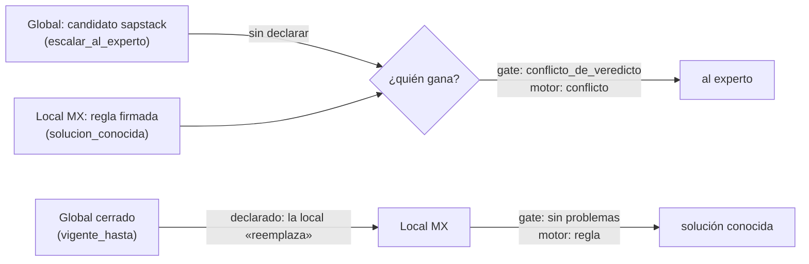
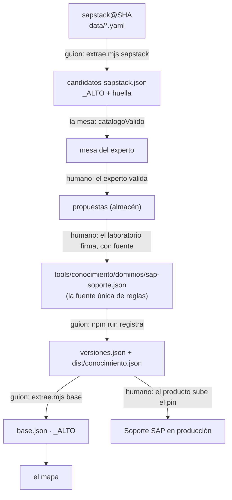
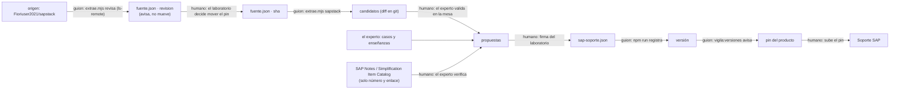

# Soporte SAP × sapstack: propuesta para mantener viva la base de conocimiento SAP

**Borrador para firma del laboratorio** · 2026-10-22 · rama `soporte/sapstack` (apilada sobre `soporte/vista-experto`) ·
sapstack fijado en `Fioriuser2021/sapstack@5be80773025a3ace996f02a5b0a8557779eaa334` (v1.4.0).
La evidencia se reproduce con `node docs/goals/soporte-sap-sapstack-evidencia/mide.mjs` (solo lectura; dos corridas dan lo
mismo) y la salida completa está en el anexo (`soporte-sap-sapstack-propuesta-anexos.md`).

## Índice

1. En una página
2. Lo que sapstack es de verdad
3. La transcripción, verificada
4. El cruce sapstack → Soporte SAP, activo por activo
5. El grafo: candidatos con su contrato y el motor corrido
6. La imprenta de CLIs: comandos y agentes por la escalera CLI-first
7. Las tres sugerencias, traducidas a lo que el template ya tiene
8. El lazo de actualización
9. La vista: lo que se construyó
10. Plan por fases, decisiones del laboratorio, controles y costo
11. Lo que podría estar mal
12. Referencias

## 1. En una página

**Qué cambia para una consultora N2.** El agente de Soporte SAP aprende de dos fuentes vivas, el experto en la mesa y lo
que SAP publica (como puntero), y de una fuente externa fijada, sapstack, que entra como **hipótesis**. Cada mes la base
sabe más porque el experto valida hipótesis en la mesa (hoy hay 266 en los módulos que atendemos) y el laboratorio firma
las que tienen una fuente citable.

**Por qué ese saber no le da un veredicto inventado a su cliente.** Ningún candidato dicta veredicto: en el grafo, un
candidato sin validar va siempre «al experto» (medido en los 5 escenarios de sapstack). Una regla solo da veredicto
cuando el laboratorio la firma en `tools/conocimiento`, con fuente, versión y huella; y un choque entre reglas que nadie
declaró no lo gana nadie: el gate lo rechaza y el motor responde «al experto» (medido, sección 7.2).

**Qué pide al laboratorio.** Firmar la revisión 12 de la AISIA (borrador en `docs/goals/`), decidir D-SS-1 a D-SS-9
(sección 10.2) y desplegar la mesa con `despliega.sh`.

## 2. Lo que sapstack es de verdad

Contado sobre la copia fijada (sección 1 del anexo):

| Qué | Cuántos | Lo que dice el README |
|---|---|---|
| Módulos (plugins con un SKILL.md) | 14 | 14 |
| Subagentes / comandos | 9 / 10 | 9 / 10 |
| T-codes | **289 únicos** en 290 líneas de clave: MRBR está dos veces (líneas 539 y 933, con nombres distintos) | 279 (no cuenta los 10 de GTS de la v1.4) |
| SAP Notes (punteros) | **46** | «50+» |
| Escenarios | 5 | 5 |

**Procedencia.** MIT, `Copyright (c) 2026 BoxLogoDev`. Los badges y el CI apuntan a `BoxLogoDev/sapstack`, que **no existe
(404)**; la copia de Fioriuser2021 no está marcada como fork. Las versiones v1.1 a v1.4 son del 2026-04-11, en unas tres
horas, y no hay commits después (`git ls-remote` del 2026-10-22 = el pin). **Nadie lo mantiene.**

**Qué tan confiable es como fuente.** Secundaria, sin citas y con defectos medidos:

- **Su gate de T-codes revisa la mitad.** `check-tcodes.sh` apaga su filtro de frontmatter con cada `---`: revisa 1418 de
  2912 líneas de cuerpo de los 14 SKILL.md (49 %). Reproducido leyendo su lógica, sin ejecutarlo; la revisión
  independiente estimó 83 T-codes sin registrar que el modo estricto no ve.
- **Su CI reutilizable valida el repo equivocado**: cada guion hace `cd` a su propia raíz, así que revisa el checkout de
  sapstack, no el del que lo llama; y si no se le pasa `sapstack-ref`, baja los guiones de `main`.
- **El perfil de entorno no lo carga ningún código** (ningún agente, comando ni SKILL.md menciona `.sapstack/config.yaml`),
  y `.gitignore` no lo excluye aunque la documentación dice que sí.
- **Ni una URL** en los 14 SKILL.md; solo 2 módulos citan SAP Notes (sap-bc y sap-hcm, y la de sap-hcm no está en su
  propio dataset). sap-bc y sap-gts están en buena parte en coreano.
- **Errores de contenido** detectados en la revisión (son evaluación de un agente, **sin verificar contra SAP**: por eso
  van a la mesa): `zcsa/installed_languages = KE` para coreano (K es danés), J_1BNFE (Nota Fiscal de Brasil) usado como
  estructura coreana, VB01/VB02 por VBO1/VBO2, MBEW (una tabla) y PR00 (un tipo de condición) registrados como T-codes, y
  la nota 2269324 titulada «Simplification List» cuando el revisor la conoce como la *Compatibility Scope Matrix*.

**Conclusión.** sapstack sirve como **lista de hipótesis** con buena cobertura (289 T-codes, 46 punteros, 5 escenarios),
no como fuente citable. Cada cosa que tomemos pasa por el experto, y lo que cambie un veredicto, por la firma.

## 3. La transcripción, verificada

La transcripción del laboratorio (`Transcripcion_SAPstack_entorno_corporativov1.md`) propone tres ajustes y, de paso,
afirma cosas del repo. Contra el código (salida completa y evidencia `archivo:línea` en el anexo, sección 2):

| # | Afirmación | Veredicto | Lo que hay |
|---|---|---|---|
| T1 | `sapstack-ci-reusable.yml` se invoca desde repos corporativos | a medias | es `workflow_call`, pero apunta a un repo 404, usa `main` por defecto y actions por tag |
| T2 | Hay guía para Jenkins o GitLab CI | falsa | no aparecen en el repo |
| T3 | «Unos 279 T-codes confirmados» | a medias | 289 únicos, MRBR repetida; «confirmado» no tiene fuente por entrada |
| T4 | Jerarquía bien documentada, por módulos | cierta | secciones por módulo, `modules` y `release` |
| T5 | En Corea busca primero en la carpeta de excepciones locales y si no, la global | falsa | no hay carpeta ni respaldo; lo coreano es un perfil que nadie carga |
| T6 | `resolve-note.sh` interactúa con las actualizaciones generales | falsa | busca palabras en `data/sap-notes.yaml`; no toca reglas |
| T7 | Al actualizar lo global, el sistema aísla las dependencias | falsa | no hay dependencias declaradas entre reglas |
| T8 | `data/tcodes.yaml` es el archivo maestro | a medias | es la lista contra la que se valida; nada se genera de él |
| T9 | `build-multi-ai.sh` traduce el YAML a todas las plataformas | falsa | no lee el YAML; inyecta bloques que ningún archivo de destino tiene |
| T10 | Los generados llevan banner «ALTO» | falsa | ninguno de los 7 archivos de destino lo lleva |
| T11 | `CONTRIBUTING.md` es el lugar del diagrama | cierta | existe, sin diagrama |
| T12 | Hay validaciones locales que mapear a CI | cierta | 8 guiones de validación y un `ci.yml` |

Las tres sugerencias son buenas ideas sobre un mecanismo que **en sapstack no existe**. Por eso no se le escriben a
sapstack (es de un tercero: solo se consume): se traducen a mecanismos del template que sí existen (sección 7).

## 4. El cruce sapstack → Soporte SAP, activo por activo

Medido con el `dist` de Soporte SAP (anexo, sección 3):

| Activo de sapstack | Destino en Soporte SAP | Medida de hoy | Riesgo | Valida | Firma |
|---|---|---|---|---|---|
| `data/tcodes.yaml` (289) | **triage** (`categoriza.transaccionDe`) | reconoce **16 de 289** (25 en su tabla) | un T-code mal asignado sube o baja la prioridad de un cliente (C4) | el experto, en la mesa | el laboratorio: tabla generada de reglas firmadas (D-SS-6) |
| `data/tcodes.yaml` (nombres) | **léxico del anonimizador** | tapa como nombre **274 de 276** nombres de transacción y 45 de 289 T-codes («Abrí ABAP [NOMBRE]») | añadir palabras al léxico decide qué NO se tapa: un apellido homógrafo (Miró ↔ MIRO, Ramos) dejaría pasar a una persona | el experto + una fila de la matriz con su sabotaje | el laboratorio (C4, revisión AISIA) |
| `data/sap-notes.yaml` (46) | **fuente de una regla** (`fuente_url`) | 44 en alcance; títulos sin verificar (2269324) | citar mal una nota da autoridad falsa | el experto, contra SAP for Me | el laboratorio, con la regla |
| `docs/scenarios` (5) | **casos de la mesa** y prueba del motor | 5/5 van «al experto» con candidatos; 3/5 sin módulo hoy | ninguno: son sintéticos | — | — |
| `commands/` (10), `agents/` (9) | **CLIs** propuestos (sección 6) | ninguno se imprime; 1 tiene CLI oficial (abaplint) | lo que mueve dinero (F110) es destructivo: daño a terceros no firmable | el laboratorio | CDC (C1) |
| `plugins/*/SKILL.md` (14) | **ninguno directo** | sin citas, 2 en coreano, errores de contenido | traer skills de fuera es CDC y metería afirmaciones sin fuente | — | — (se usan como temas para que el experto escriba casos) |
| `.sapstack/config.*` (perfil) | la **idea** para la matriz de herencia (sección 7.2) | ningún código lo lee | — | — | — |
| CI y guiones | **ninguno**: se proyecta el padrón propio (sección 7.1) | validan el repo equivocado, sin SHA | — | — | — |

Por módulo, entran como candidatos **222 de 289 T-codes** (FI, MM, SD, BASIS/BC, HCM, ABAP) y 44 de 46 notas; quedan
fuera PP (29), GTS (16), CO (16 de 17) y TR (6), que Soporte SAP no atiende hoy (D-SS-5).

## 5. El grafo: candidatos con su contrato y el motor corrido

Los 222 T-codes en alcance se escribieron **con el contrato del grafo** (`contrato.ts`) en un paquete de prueba
`0.0.1-candidato`, dominio `sap-soporte`, dimensión `soporte_sap` (`solucion_conocida | escalar_al_experto`), con cada regla
citando su `archivo:línea` de sapstack y **veredicto `escalar_al_experto`, grado `hipotesis`**. Nunca se registró ni entró
a `tools/conocimiento`.

- `validaConocimiento`: **ok**, 222 categorías y 222 reglas, sin problemas; ninguna keyword choca con las del catálogo
  real. Una contención sin cubrir (`stms` ⊂ `stms_import`): el gate la pediría declarada.
- El motor (`evalua`) sobre los 5 escenarios, contados en español:

| Escenario | Hoy (`categoriza`) | Con candidatos | Destino |
|---|---|---|---|
| 01 MIRO sin código de impuesto | sin módulo | `ME23N` (gana la keyword más larga: el texto nombra MIRO **y** ME23N) | al experto (hipótesis) |
| 02 F110 no genera el DME | sin módulo | `F110` | al experto (hipótesis) |
| 03 AFAB con dump DBIF_RSQL_SQL_ERROR | BASIS (por el dump) | `AFAB` | al experto (hipótesis) |
| 04 CVI no convierte clientes a BP | sin módulo | sin regla | al experto (sin regla) |
| 05 CONVT_CODEPAGE tras SUM | sin módulo | sin regla | al experto (sin regla) |

**Lo que enseña.** (1) Ningún candidato da veredicto: el diseño aguanta. (2) **Un T-code como keyword no basta para
categorizar**: en el 01 el agente elegiría la transacción equivocada. Antes de alimentar el triage hace falta una
relación más rica en el grafo: **T-code ↔ módulo ↔ síntoma o dump ↔ puntero a nota ↔ release (ECC/S4)**, para que
«MIRO + código de impuesto» gane a «ME23N» por síntoma y no por longitud. (3) Los escenarios 04 y 05 piden reglas por
síntoma (CVI, CONVT_CODEPAGE), no por transacción: eso solo lo puede enseñar el experto.

**Qué cambiaría en `categoriza` y `mapeo`.** `TRANSACCIONES` (25 a mano) pasaría a ser una tabla **generada** desde las
categorías firmadas de `sap-soporte`, con banner y huella, en vez de una segunda lista; `MENSAJES` ganaría los dumps y
mensajes que el experto valide. `mapeo.ts` no cambia: mapea columnas de exportes, no T-codes.

## 6. La imprenta de CLIs: comandos y agentes por la escalera CLI-first

Peldaños: **1** ya lo cubre un `ss-*`; **2** publicado en la librería (595 CLIs; de SAP solo `pp-concur`, que no es ERP) o
un CLI oficial; **3** imprimir (3+ repeticiones **y** API real: imprimir contra un SAP real choca con **D6**); **4** el
modelo (Soporte SAP no usa modelo, D7: lo útil entra como regla firmada). Sin grado, todo es «no medido».

| De sapstack | Qué hace | Peldaño | Solo lectura | Simula por defecto | Destructivo |
|---|---|---|---|---|---|
| `sap-abap-review` | revisión de código ABAP local | **2: `@abaplint/cli` 2.120.86 (MIT), CLI oficial**; adoptarlo es CDC | sí | — | no |
| `sap-migo-debug` | diagnóstico de MIGO | **1: `ss-triage` + `ss-simulador`** (M7 053 / MMPV en el laboratorio) | sí | sí | no |
| `sap-payment-run-debug` | diagnóstico de F110 | 4 + experto: el diagnóstico lee, pero pide el SAP real (D6) | sí (diagnóstico) | — | **el arreglo sí: F110 mueve dinero** |
| `sap-fi-closing`, `sap-quarter-close`, `sap-year-end` | cierres con contabilizaciones (y F110) | **no se imprime**: gate humano | no | — | **sí** (no firmable) |
| `sap-transport-debug` | STMS: reimportar, importar sin condiciones | no se imprime: cambia producción | no | — | sí |
| `sap-performance-check` | diagnóstico por capas (ST05 activa una traza) | 4: pide el SAP real (D6) | casi | — | no |
| `sap-s4-readiness` | readiness para S/4 | 2: la herramienta de SAP (`/SDF/RC_START_CHECK`) | sí | — | no |
| `sap-korean-tax-invoice-debug` | e-Tax Invoice de Corea | no aplica (México usa CFDI: `ss-triage` ya mira `CFDInnnnn`) | sí | — | no |
| los 9 agentes (`sap-*-consultant`, `-troubleshooter`, `-reviewer`, `-advisor`, `-analyzer`) | asesoría con Read/Grep/Glob | 4 → no aplica (sin modelo): su contenido, como candidatos para el experto | sí | — | no |

Ninguno cumple hoy «3+ repeticiones y API real». La vía que ya existe sigue siendo la buena: el experto enseña una
operación repetible en la mesa, el chat **propone** el CLI (`tools/soporte-sap/src/chat.ts:76`) y el laboratorio lo
aprueba por CDC.

## 7. Las tres sugerencias, traducidas a lo que el template ya tiene

### 7.1 CI empresarial: el padrón de gates, proyectado

El template ya tiene **un** padrón (`.claude/gates.json`, `npm run gates`) y un ejecutor (`node scripts/corre-gates.mjs
validate`). La propuesta: `proyecta:gates` (que hoy emite reglas para hermes) emite también el CI de cada plataforma,
**generado** con banner, nunca escrito a mano, con todo fijado por SHA o digest. Los fragmentos completos están en el
anexo (sección 5); el de GitHub Actions:

```yaml
# ALTO: ARTEFACTO AUTOGENERADO desde .claude/gates.json (npm run proyecta:gates -- --ci github). No lo edites.
name: gates
on: [pull_request]
permissions: { contents: read }
jobs:
  validate:
    runs-on: ubuntu-24.04
    steps:
      - uses: actions/checkout@3d3c42e5aac5ba805825da76410c181273ba90b1 # v7.0.1
      - uses: actions/setup-node@949feb2413d6458794dcd2491c4babbbce0c15c1 # v7.1.0
        with: { node-version: '22.18.0' }
      - run: npm ci
      - run: node scripts/corre-gates.mjs validate
```

Cambiar el padrón o su proyección es un **CDC** (C1): lo decide D-SS-8.

### 7.2 Matriz de herencia: quién gana cuando chocan

La transcripción imagina una búsqueda por capas («primero lo local, si no, lo global»). El motor del template no busca
por capas: **evalúa todas las reglas vigentes del ámbito, y la precedencia existe solo si está declarada**. Probado en el
motor con F110 (anexo, sección 4):



| Choque | Quién gana | Dónde vive la declaración |
|---|---|---|
| Global ↔ local, **declarado** | lo local (la global se cierra con `vigente_hasta` y la local `reemplaza`) | la regla local, firmada |
| Global ↔ local, **sin declarar** | **nadie**: el gate lo rechaza y el motor responde «al experto» | — |
| Dos keywords que se contienen | la frase más larga (la del dominio más específico) | `contenciones-aceptadas.json`, con su porqué |
| A medida (consultora o cliente) ↔ núcleo | lo a medida se queda en su consultora; subir al núcleo pide consentimiento (D1) | la base, al promover |
| Candidato ↔ regla firmada | la regla: un candidato nunca da veredicto | el grado `hipotesis` |

Niveles, de lo general a lo particular: **SAP estándar** (global) → **localización MX** (CFDI, SAT: `generales/mx-*`) →
**consultora (N2)** → **cliente (N3)**. Es la lógica de *deny-overrides* de XACML llevada a soporte: ante la duda, no hay
veredicto. Una precedencia que cambie un veredicto la firma el laboratorio.

### 7.3 Fuente única y artefactos generados



Ya construido: `candidatos-sapstack.json` y `base.json` llevan **`_ALTO` como primera clave** («ALTO: ARTEFACTO
AUTOGENERADO. Si lo editas, tus cambios se pierden… y la mesa lo rechaza por su huella»), y dos comparadores: la mesa no
carga un catálogo editado (fila `c3-mesa-candidatos-fijados`) y una prueba regenera `base.json` y falla si quedó viejo.
Para el resto del repo, el patrón existe en `sincroniza:gemini` (GEMINI.md se genera de AGENTS.md y el verificador
rechaza editarlo a mano). Extenderlo a todo generado es un CDC del padrón (D-SS-9).

## 8. El lazo de actualización



**La verdad incómoda.** sapstack está quieto desde el 2026-04-11 y su origen ya no existe: **no es una fuente viva**. El
aviso de commit nuevo existe por si vuelve a moverse, pero el lazo no depende de él. Las fuentes vivas son **el experto**
(sus casos, sus enseñanzas y sus validaciones en la mesa) y **lo que SAP publica**: las notas cambian de versión y el
catálogo de simplificación tiene fecha, así que el experto las verifica en SAP for Me y la regla cita **solo el número y el
enlace** (el contenido es de SAP; sus términos de uso no permiten copiarlo).

## 9. La vista: lo que se construyó

- **Validar conocimiento** (`/mesa/soporte-sap?pestana=candidatos`, para cualquier identidad de la mesa): cada candidato
  como **hipótesis**, con su fuente a la vista (archivo y línea en el SHA, licencia), filtros por módulo y tipo, y cuatro
  respuestas: es correcto, está mal, lo corrijo (pide la corrección), no lo sé. Lo dicho queda como **propuesta**.
- **El mapa** (`/mesa/soporte-sap/laboratorio`, solo el laboratorio): fuentes → `sap-soporte` → lo que la usa, con su
  conteo, nodos que se despliegan y abren su detalle, siete métricas con su serie de 14 días («sin datos» cuando no hay),
  las propuestas de los expertos, las versiones de la base y los pins. Cada número sale de lo guardado, del catálogo, de
  `base.json` o del código de Soporte SAP corrido sobre el catálogo.
- **Seguridad**: cinco filas nuevas en la matriz, cada una verde sin su sabotaje y roja con él
  (`c3-mesa-candidato-propuesta`, `c3-mesa-candidatos-propios`, `c3-mesa-mapa-laboratorio`, `c3-mesa-candidatos-fijados`,
  `aisia-mesa-candidato-filtrado`). Sin rutas nuevas: todo va por `?pestana=` y `?vista=`.
- **Un fallo de la mesa, arreglado de paso**: el id de un caso podía tener forma de número de documento
  (`c-mvjjiz61-023329`) y el filtro rechazaba toda acción sobre él; 68 de 3000 ids (prueba roja → verde).

## 10. Plan por fases, decisiones del laboratorio, controles y costo

### 10.1 Fases

| Fase | Qué | Gate |
|---|---|---|
| F0 (hecha) | catálogo fijado, validación en la mesa, mapa, filas, evidencia | validate en verde, matriz entera |
| F1 | firmar la revisión 12 de la AISIA y desplegar la mesa | firma + `despliega.sh` (laboratorio) |
| F2 | el experto valida los 222 T-codes en alcance, primero los 206 que el triage no reconoce | ≥ 1 validación por candidato antes de proponer reglas |
| F3 | primera regla `sap-soporte` firmada (una relación síntoma ↔ T-code ↔ nota) | D-SS-2/3; nueva versión con `npm run registra`; CAMBIOS con firma |
| F4 | el triage lee la tabla generada de las categorías firmadas | revisión AISIA (la prioridad afecta al cliente) + matriz |
| F5 | el léxico gana vocabulario SAP medido | fila de la matriz con su sabotaje; sin homógrafos de apellidos |
| F6 | CI proyectado desde el padrón y banners en todo generado | CDC del padrón |

### 10.2 Decisiones del laboratorio

| # | Decisión | Recomendación |
|---|---|---|
| D-SS-1 | ¿Se despliega la mesa con la validación de candidatos? | **Sí**, después de firmar la revisión 12 |
| D-SS-2 | ¿Qué es una fuente citable para una regla `sap-soporte`? | **Una SAP Note o SAP Help verificada por el experto (número y enlace), o la experiencia documentada del experto; sapstack nunca por sí solo** |
| D-SS-3 | `cita` del dominio: la suite de `tools/conocimiento` exige `publica` y un corte entre 2026-07-01 y 2026-09-06 | **Abrir `interna` para `sap-soporte`**, con su prueba (CDC de la suite) |
| D-SS-4 | ¿Se mueve el pin de sapstack cuando haya commits? | **No en automático**: el laboratorio decide tras ver el diff de candidatos |
| D-SS-5 | Alcance: PP, GTS, CO y TR quedan fuera | **Mantenerlo**; CO solo cuando va con FI |
| D-SS-6 | ¿El triage se alimenta de T-codes validados? | **Sí, solo desde categorías firmadas**, como tabla generada (no una segunda lista) |
| D-SS-7 | ¿El léxico gana el vocabulario de sapstack? | **Sí, término por término medido**, con fila en la matriz; excluir homógrafos de apellidos |
| D-SS-8 | ¿Se proyecta el CI desde el padrón? | **Sí, GitHub Actions primero** (CDC); GitLab y Jenkins cuando una consultora lo pida |
| D-SS-9 | ¿Banners y gate para todo artefacto generado? | **Sí**, extendiendo el patrón de `sincroniza:gemini` (CDC del padrón) |

### 10.3 Controles y costo

- **CDC (C1)**: D-SS-3, D-SS-8, D-SS-9 y adoptar `@abaplint/cli`. Ningún skill, agente ni MCP de sapstack se instala.
- **AISIA (C4)**: la **revisión 12** (borrador `docs/goals/soporte-sap-AISIA-revision-sapstack.md`): una fuente externa
  de candidatos entra a la mesa y las validaciones del experto se guardan como propuestas. F4 y F5 piden otra revisión.
- **C5**: ninguno. Los candidatos son datos públicos de un tercero (MIT); nada aquí es un riesgo que se firme por otros.
- **Costo**: sin APIs de pago ni modelo. La mesa ya corre en Workers Paid (US$5/mes) y R2; lo nuevo pesa ~230 KB. El
  costo real es el tiempo del experto: ~2 h para los 222 T-codes a 30 s cada uno.

## 11. Lo que podría estar mal

| Riesgo | Estado |
|---|---|
| Los errores de contenido de sapstack (sección 2) son evaluación de un agente, sin verificar contra SAP | **por diseño**: son hipótesis y los decide el experto |
| Un T-code como keyword elige la transacción equivocada (MIRO → ME23N) | **abierto**: F4 no empieza sin la relación síntoma ↔ T-code |
| El filtro de la mesa rechaza un número de nota (7 cifras) dentro de un comentario | **abierto, a propósito**: cambiar el filtro es AISIA; el candidato ya lleva su número |
| Los ids de candidato con cifras chocaban con el filtro | **resuelto**: ids sin cifras (prueba) |
| El id de un caso con forma de documento dejaba el caso sin poder calificarse | **resuelto**: 68/3000 → 0 (prueba roja → verde) |
| `base.json` se queda viejo tras un `registra` | **resuelto**: una prueba lo regenera y compara |
| Un catálogo editado a mano | **resuelto**: la mesa lo rechaza por su huella (fila con sabotaje) |
| Las notas de sapstack en coreano aparecen sin traducir (8) | **declarado**: se marcan «en coreano»; sin modelo no se traduce |
| Las validaciones vencen a los 180 días, como los casos | **declarado**: el laboratorio exporta antes (el export las lleva) |
| El laboratorio, haciendo de experto, cuenta como experto en las métricas | **declarado**: es la decisión del 22/10 («yo voy a ser el experto por lo pronto») |
| La medida de `check-tcodes.sh` reproduce su lógica sin ejecutarlo | **contrastado**: la revisión independiente llegó a lo mismo |
| El catálogo se manda entero a la pantalla (~200 KB por visita) | **aceptable hoy**; paginar en el servidor si crece |

## 12. Referencias

- Consortium for Service Innovation, *KCS v6 Practices Guide*: el lazo Solve (capturar, estructurar, reusar, mejorar) y el
  lazo Evolve; los artículos que nacen al resolver y los que crea un experto de dominio a partir del reuso.
  https://library.serviceinnovation.org/KCS/KCS_v6/KCS_v6_Practices_Guide/030 · estados de un artículo (WIP, no validado,
  validado, archivado), Practice 5: https://library.serviceinnovation.org/KCS/Knowledge-Centered_Success_Practices_Guide/301-Evolve_Loop/Practice_5_Content_Health
  — los candidatos son «no validados», la validación del experto los lleva a «validado» y la firma, a regla.
- SAP, *Simplification Item Catalog, Simplification Item Check and SAP Readiness Check for SAP S/4HANA*: el catálogo tiene
  fecha y las notas, versión. https://blogs.sap.com/2020/01/02/simplification-item-catalog-simplification-item-check-and-sap-readiness-check-for-sap-s-4hana/
- SAP for Me, *Terms of Use*: los materiales de soporte se usan bajo esos términos. https://me.sap.com/assets/legal/terms-of-use.html
- OASIS XACML 3.0, algoritmos de combinación (deny-overrides, permit-overrides, first-applicable), resumidos en
  https://is.docs.wso2.com/en/5.9.0/learn/introduction-to-xacml-3.0-policies — la precedencia se declara; sin
  declaración, ningún «gana el más específico» silencioso.
- Cloudflare, el Overview de un Worker (captura del laboratorio del 22/10): el modelo del mapa.
