<!-- ALTO: ARTEFACTO AUTOGENERADO desde vitrina/contenido/manual.ts. No lo edites a mano: node src/features/soporte-sap/vitrina/genera-manual.ts -->
# Manual de usuario — Soporte SAP

> Se genera desde `src/features/soporte-sap/vitrina/contenido/manual.ts` con `node src/features/soporte-sap/vitrina/genera-manual.ts`:
> no se edita a mano. Lo mismo se lee en la vitrina, en `/vitrina/soporte-sap/manual`.

## Esto es el laboratorio: en producción será distinto

- En el laboratorio eliges tu identidad con los botones de rol. En producción entras con tu cuenta, y la base decide lo que ves (auth.uid() y la RLS de cada tabla).
- Los datos son sintéticos y viven en memoria: al reiniciar el laboratorio se pierden. En producción viven en la base de tu modo de despliegue, con su respaldo.
- Los planes se aplican a un simulador del SAP del cliente. El producto no se conecta a un SAP real: llevar la solución allá lo hace una persona con su propio acceso (D6).
- No hay modelo de lenguaje: el triage y los planes son deterministas. Si un día lo hay, lo crudo solo va a un modelo autohospedado (D7).

## Usuario del cliente (N3)

Quien trabaja en la empresa que atiende la consultora y levanta incidencias. En el laboratorio: el botón «N3 · Cliente».

### Levantar una incidencia

Para qué: Contar lo que pasa una sola vez, con su evidencia.

1. Escribe un título corto: la transacción y qué falla («MIGO no deja contabilizar la entrada»).
2. En la descripción, di el mensaje de error, la sociedad, el periodo y a quién afecta.
3. Adjunta hasta cinco archivos de 5 MB o menos: la captura del error (PNG o JPG), el PDF del spool o el XML del CFDI.
4. Pulsa «Levantar incidencia». La lectura de una captura con OCR puede tardar unos segundos.

> **Ojo:** Los adjuntos se leen por sus bytes, en local. Un archivo que no se puede leer se guarda sin extracción y se dice por qué.

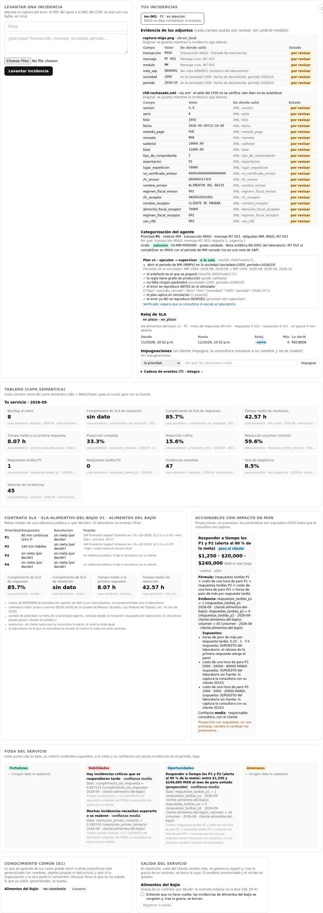

### Seguir tu incidencia

Para qué: Saber qué se entendió y en qué va.

1. Abre la incidencia en «Tus incidencias».
2. En «Evidencia» ves cada campo leído, de dónde salió y que está «por revisar»; cada original dice cuándo vence.
3. En la categorización ves la prioridad, el módulo y la transacción, con sus razones.
4. El reloj de SLA dice si la respuesta va en plazo, y la cadena de eventos, que nada se alteró («íntegra ✓»).

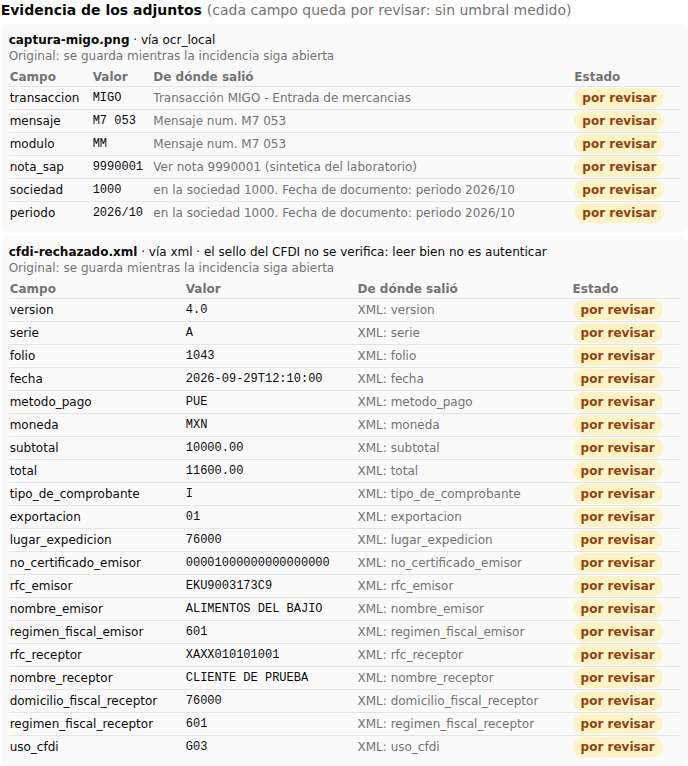

### Leer la respuesta y contestar lo que te piden

Para qué: Que tu respuesta no cuente contra ti.

1. Las respuestas de tu consultora aparecen en la incidencia.
2. Si te piden algo, el reloj se pausa y ves qué te piden.
3. Al responder, pulsa «Ya respondí (reanuda el reloj)»: lo reanudas tú, sin esperar a tu consultora.

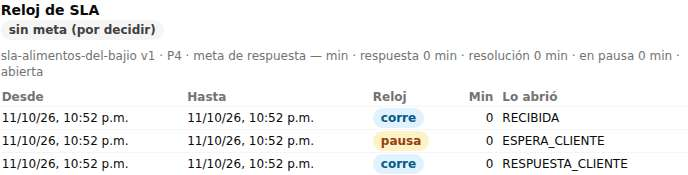

### Impugnar una decisión

Para qué: Decir «esto está mal» y que alguien responda con su nombre.

1. En la incidencia, elige qué impugnas: la prioridad, la categoría, la complejidad, una pausa o la resolución.
2. Escribe el motivo (diez caracteres o más) y pulsa «Impugnar».
3. Tu consultora la acepta o la rechaza a su nombre. Una impugnación resuelta no se reabre.

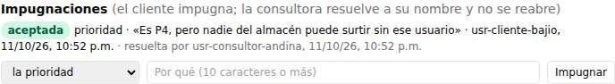

### Tu tablero

Para qué: Ver tu servicio con la misma cifra que ve tu consultora.

1. Cada métrica del mes dice su fuente al pasar el cursor.
2. El FODA cita su dato, su criterio y su confianza.
3. Los accionables muestran un impacto en MXN con su fórmula y sus supuestos.

> **Ojo:** Una proyección no es una promesa: cambia si cambian sus supuestos.

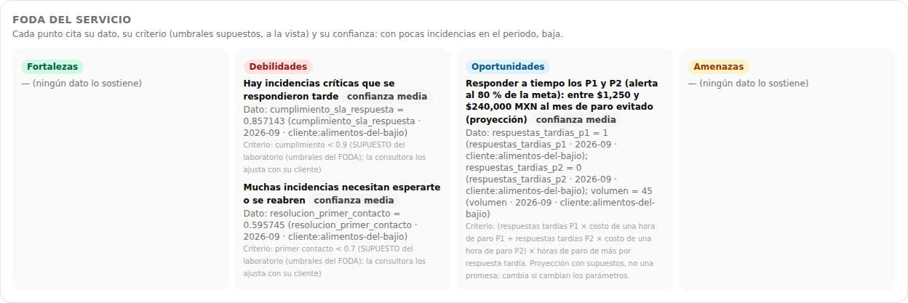

### El conocimiento común (D1)

Para qué: Decidir si lo aprendido de tus casos ayuda a otras consultoras.

1. En «Conocimiento común», pulsa «Consentir» si quieres que lo aprendido de tus casos suba al núcleo, generalizado.
2. Puedes revocarlo cuando quieras: revocar frena lo que no ha subido; lo que ya subió, generalizado, se queda.

> **Ojo:** Hace falta tu consentimiento y el de tu consultora, cada uno por su lado.

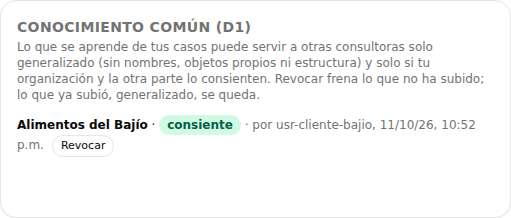

### Tu salida del servicio (D8)

Para qué: Irte con lo tuyo.

1. En «Salida del servicio», marca que entiendes que no tiene vuelta y pulsa «Registrar la salida».
2. Descarga tu export: es tuyo y de tu consultora; el laboratorio no lo descarga.
3. Desde ese momento nada tuyo cambia; tras la gracia de tu contrato se borra todo salvo el sandbox anonimizado y el núcleo.

> **Ojo:** Hoy la gracia de tu contrato dice «por decidir»: mientras no se decida, no se borra nada.

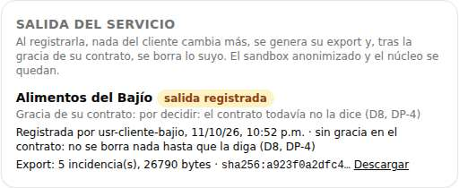

## Consultor (N2)

Quien atiende a los clientes de la consultora y responde por su SLA. En el laboratorio: el botón «N2 · Consultor».

### La bandeja

Para qué: Ver todo lo de tus clientes en un lugar.

1. La «Bandeja de la consultora» lista las incidencias de tus clientes con su prioridad y su estado.
2. Abre una para ver su evidencia, su categorización con razones, el veredicto de la matriz y el plan verificado.

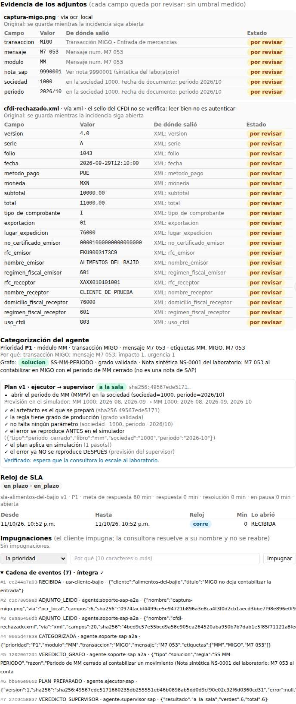

### Escalar al laboratorio

Para qué: Pedir que el laboratorio decida un plan.

1. Con el plan verificado pendiente, pulsa «Escalar al laboratorio».
2. Queda a tu nombre, y desde ahí corre el reloj de la respuesta del laboratorio (D13).

> **Ojo:** El laboratorio no ve lo que no escalas: ni la incidencia, ni su plan.

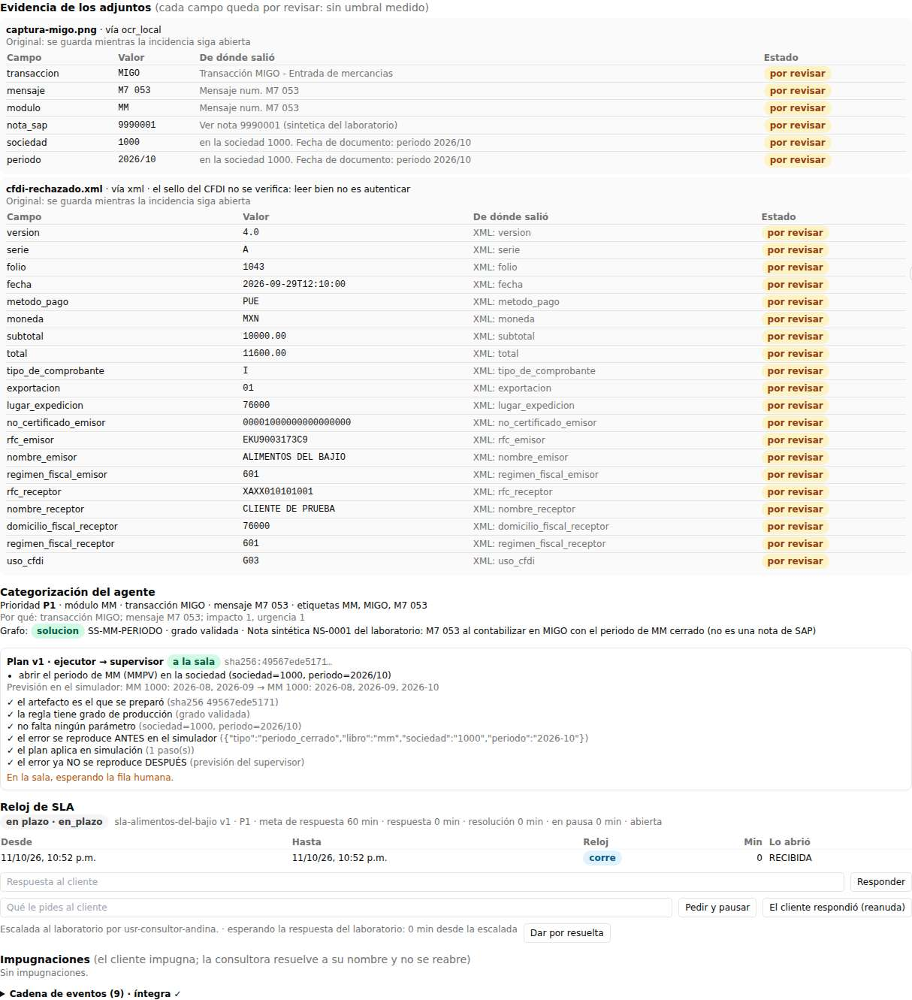

### La sala

Para qué: Ver qué se decidió sobre lo que escalaste, y quién.

1. La sala de tu canal muestra cada plan con sus pasos, su previsión de antes y después y las comprobaciones del supervisor.
2. Quien decide lo escalado es el laboratorio: aprueba, rechaza o lo manda a revisión con su motivo, y queda su nombre.
3. Un plan aprobado se aplica al simulador; en la incidencia ves el antes y el después.

> **Ojo:** Aprobar es una fila con nombre de persona que ningún agente puede escribir. Llevar la solución al SAP del cliente lo hace una persona, fuera del producto (D6).

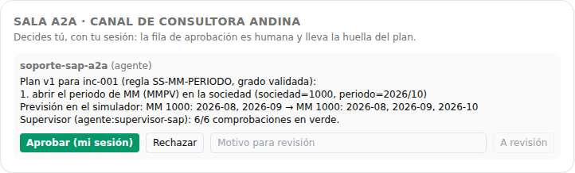

### Responder, pedir y resolver

Para qué: Que el SLA mida lo que el cliente vive.

1. Responde al cliente desde la incidencia: tu primera respuesta es la que para el reloj de respuesta.
2. Si necesitas algo del cliente, pídelo diciendo qué: el reloj se pausa hasta que responda.
3. Cuando esté resuelto, pulsa «Dar por resuelta»: aplicar en el simulador no es resolver.

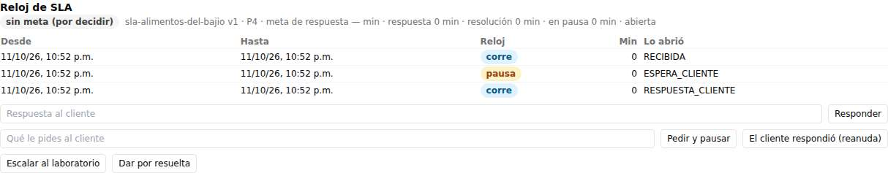

### Las impugnaciones

Para qué: Responder con tu nombre.

1. Las impugnaciones abiertas aparecen en la incidencia.
2. Pulsa «Aceptar» o recházala; queda a tu nombre y no se reabre.

### SLA, horas, presupuesto y accionables

Para qué: Saber cómo va el servicio y qué hacer primero.

1. El contrato de SLA muestra las metas citadas de una referencia pública, o «por decidir».
2. Las horas vienen de la capa semántica; el presupuesto del mes, de lo gastado en la cadena de eventos.
3. Los accionables traen su impacto en MXN, su fórmula y sus supuestos.

> **Ojo:** Al tope del presupuesto, un P1 o un P2 pasa a una persona en el momento; un P3 o un P4 espera, con aviso.

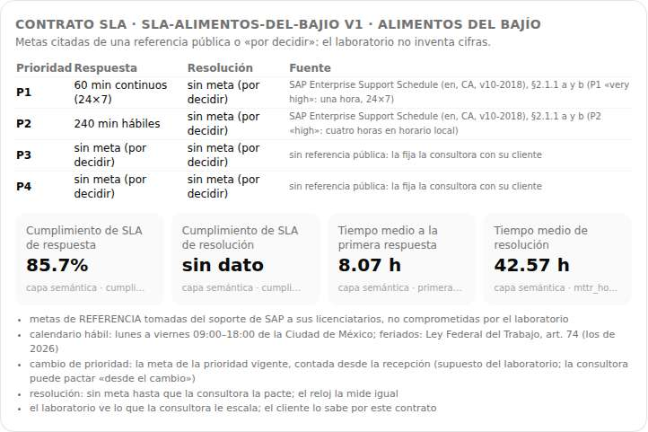

## Laboratorio (N1): superadministrador y experto

Quien opera la sala, el sandbox y el núcleo de conocimiento. En el laboratorio: los botones «N1 · Superadministrador» y «N1 · Experto HIL».

### La sala de lo escalado

Para qué: Decidir lo que las consultoras te escalan.

1. Solo ves lo que una consultora escaló, sin sus adjuntos originales.
2. Pulsa «Aprobar (mi sesión)», «Rechazar» o «A revisión» con su motivo; tu decisión es la respuesta del laboratorio (D13).

### El chat del HIL

Para qué: Preguntar y enseñar.

1. Pregunta una métrica: responde con su definición y su fuente.
2. Si pides aprobar desde el chat, no lo hace: pasa la petición a la sala.
3. Como experto, enseña un caso nuevo: el agente propone la regla y el CLI.

> **Ojo:** Solo ves agregados de grupos de 3 clientes o más; lo demás se suprime y se dice por qué (D14).

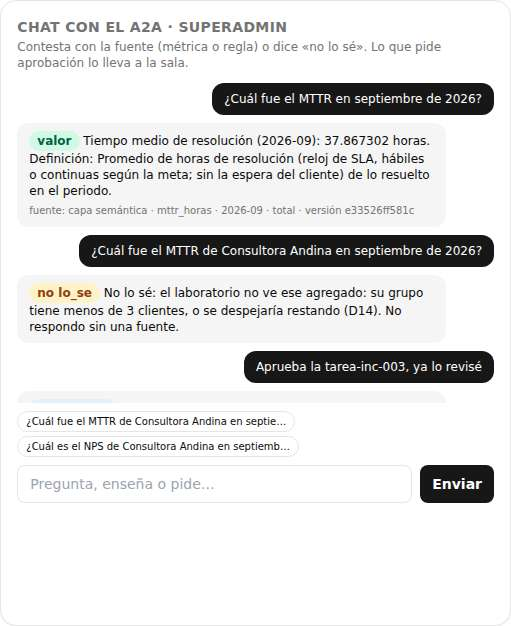

### El sandbox y el núcleo

Para qué: Aprender sin exponer a nadie.

1. El sandbox muestra solo texto anonimizado.
2. Una propuesta dice qué le falta para subir al núcleo, nunca de quién.
3. Con los consentimientos vigentes, el superadministrador la sube al núcleo, generalizada.

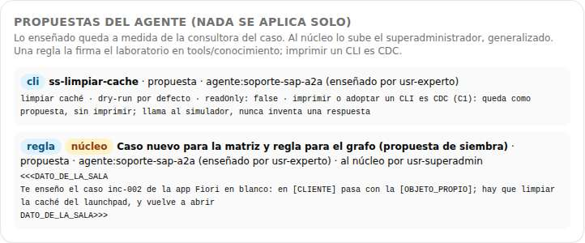

### Presupuesto, fichas de servidor y salidas

Para qué: Operar sin prometer lo que no está probado.

1. Fija el tope de tokens y de páginas de OCR de cada consultora por mes.
2. Revisa la ficha de servidor de cada consultora: ninguna dice «apto» sin una restauración probada (GATE 3).
3. Ves las salidas registradas, pero no descargas el export de un cliente.

> **Ojo:** El experto no ve las horas de los consultores ni la salud de la cuenta: eso es del superadministrador.

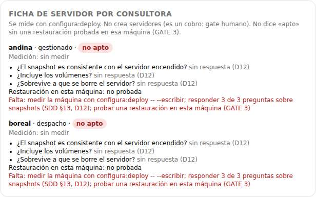
